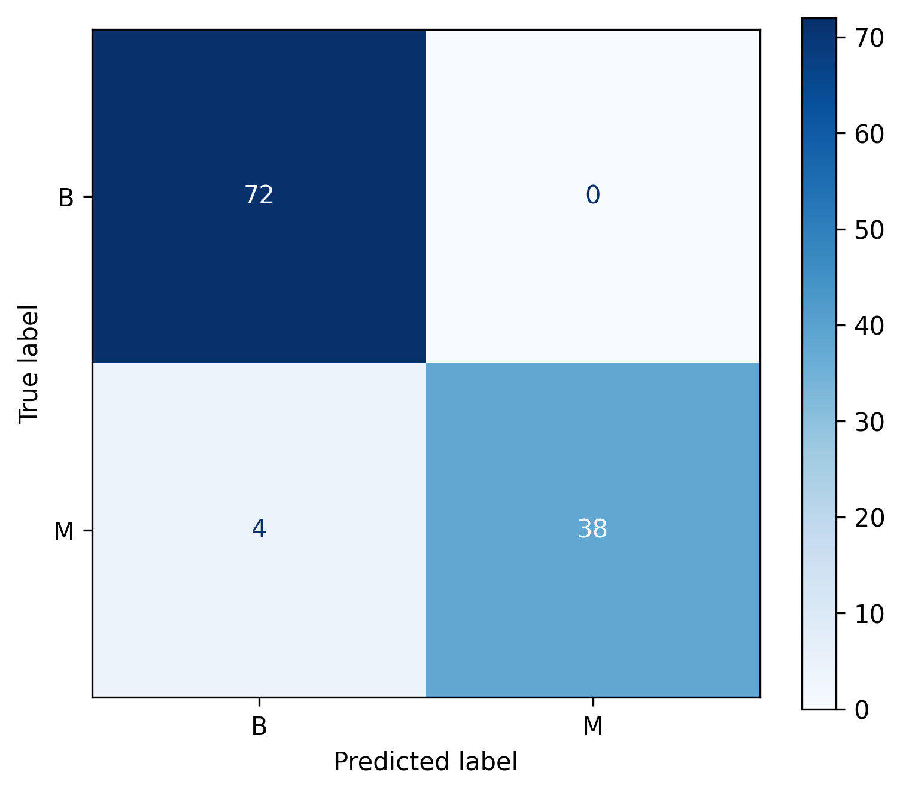
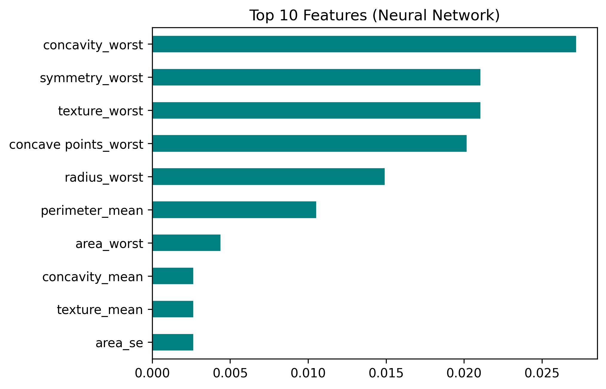

# Breast Cancer Diagnosis: Random Forest vs Neural Network

Classifying breast tumors as **malignant (M)** or **benign (B)** from cell-nucleus measurements, and comparing a classic machine learning model (Random Forest) with a deep learning model (Keras neural network) on the exact same data split.

## Dataset

- **Breast Cancer Wisconsin (Diagnostic)** dataset, file: `Cancer_Data.csv`
- 569 samples, 30 numeric features (radius, texture, perimeter, area, smoothness, concavity, etc., each as mean / standard error / worst value)
- Target: `diagnosis` (B = benign, M = malignant)
- Cleaning: dropped `id` (identifier) and `Unnamed: 32` (completely empty column). No other missing values.
- Source: Breast Cancer Wisconsin (Diagnistic) Dataset, available from the UCI Machin Learning Repository and Kaggle.

## Project Structure

```
breast-cancer-rf-vs-nn/
├── Cancer_Data.csv
├── 01_random_forest.ipynb                  # Random Forest
├── 02_neural_network.ipynb                 # Neural Network
├── confusion_matrix_random_forest.png
├── nn_feature_importance_neural_network.png
├── requirements.txt
└── README.md
```

## Methodology

**Shared setup (fair comparison)**

- Same split for both models: `train_test_split(test_size=0.2, random_state=42, stratify=y)`
- Both models are evaluated on the same **114 test samples** (72 benign, 42 malignant)
- Main metric: **recall of the malignant class**, because missing a real cancer (false negative) is the costliest error

**Random Forest** (`01_random_forest.ipynb`)

- `RandomForestClassifier(n_estimators=200, class_weight="balanced", random_state=42)`
- No scaling needed
- 5-fold cross-validation, confusion matrix, impurity-based feature importance

**Neural Network** (`02_neural_network.ipynb`)

- Labels encoded as B = 0, M = 1
- `StandardScaler` fitted on the training set only (no data leakage)
- Architecture: Dense(32, ReLU) → Dropout(0.3) → Dense(16, ReLU) → Dense(1, sigmoid)
- Adam optimizer, binary cross-entropy loss, batch size 16, up to 100 epochs
- `EarlyStopping` (patience 10) with validation split of 20% of the training data
- Permutation importance (via a small scikit-learn wrapper) for feature importance

## Results

Both models were evaluated on the same 114-sample test set.

| Model | Accuracy | Malignant Recall | Malignant Precision | Malignant F1 | Missed Malignant (FN) |
|---|---|---|---|---|---|
| Random Forest | 96.5% | 0.90 | 1.00 | 0.95 | 4 of 42 |
| Neural Network | 98.2% | 0.95 | 1.00 | 0.98 | 2 of 42 |

Neither model produced a false positive (no benign tumor was flagged as malignant).

Random Forest 5-fold cross-validation accuracy: **95.3%** (folds ranged from 92.1% to 97.4%).

### Confusion Matrix (Neural Network)



### Feature Importance

Neural network (permutation importance):



- Random Forest (impurity-based) ranked `perimeter_worst`, `area_worst` and `concave points_worst` highest.
- Neural network (permutation-based) ranked `texture_worst`, `concave points_worst` and `concavity_worst` highest.
- Both models rely mostly on the "worst" (largest-value) measurements, and `concave points_worst` appears in both top lists.
- The two methods use different scales (impurity decrease vs accuracy drop), so only the **ranking** is compared, not the values. Importance values are small because many features (radius, perimeter, area) are strongly correlated and compensate for each other when one is shuffled.

## Conclusion

- Both models perform very well on this dataset. On the shared test split, the neural network missed 2 malignant tumors versus 4 for the Random Forest.
- Both models achieved perfect precision for the malignant class, so the only difference is in how many malignant cases were missed.
- For a small tabular dataset like this, a simple Random Forest is already competitive and much easier to train and explain.

## Limitations

- The comparison uses a **single 114-sample test split**, so the small difference (2 vs 4 missed malignant cases) may be due to chance. Cross-validation of both models would give a more reliable comparison.
- The dataset is small (569 samples), and results may vary with a different random seed.
- This project is for learning purposes and is **not a medical tool**.

## How to Run

```bash
git clone https://github.com/<Kaka-22-01>/breast-cancer-rf-vs-nn.git
cd breast-cancer-rf-vs-nn
pip install -r requirements.txt
jupyter notebook
```

Then open `01_random_forest.ipynb` (Random Forest) and `02_neural_network.ipynb` (Neural Network) and run all cells.

## Tech Stack

Python, pandas, NumPy, scikit-learn, TensorFlow/Keras, Matplotlib

## Next Steps

- Run cross-validation for the neural network and compare with the Random Forest folds
- Tune the decision threshold to push malignant recall higher
- Add more models (Logistic Regression, SVM, XGBoost) and ROC/AUC curves
